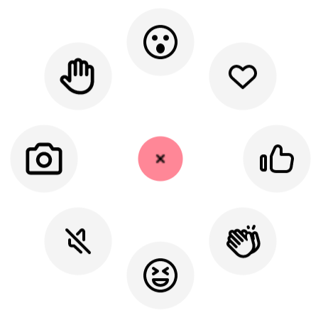
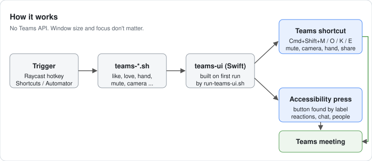

# teams-meeting-controls

Hotkey scripts for Microsoft Teams meetings on macOS: reactions (👍 ❤️ 👏 😂 😮), raise/lower hand, mute, camera, share, chat, people.
Works at any window size; Teams doesn't need focus. No Teams API setup, no Raycast required.

| Script | Action | How |
|---|---|---|
| `teams-react-{like,love,applause,laugh,wow}.sh` | Reaction | Accessibility button press |
| `teams-hand-toggle.sh` | Raise/lower hand | Cmd+Shift+K |
| `teams-mute.sh` | Mute/unmute | Cmd+Shift+M |
| `teams-camera.sh` | Camera on/off | Cmd+Shift+O |
| `teams-share.sh` | Share | Cmd+Shift+E |
| `teams-chat.sh`, `teams-people.sh` | Open panel | Accessibility button press |

## Requirements
- macOS 14+, new Microsoft Teams
- Xcode Command Line Tools: `xcode-select --install`
- Accessibility permission for whatever launches the script

The helper (`lib/teams-ui`) is compiled on first run (~4 s). Run one script once in Terminal first so later runs are instant.
If macOS quarantines a download: `xattr -dr com.apple.quarantine <folder>`.

## Bind to keys

### Raycast
Settings > Extensions > Script Commands > Add Directory (this folder), then assign hotkeys to `Teams: …`.

### Shortcuts app (built in)
1. New shortcut, e.g. "Teams Like". Add **Run Shell Script** with the full path, e.g. `/Users/you/teams-meeting-controls/teams-react-like.sh`.
2. Shortcut details (ⓘ) > **Add Keyboard Shortcut**, press the combo.
3. Repeat per action. Pick combos Teams doesn't use, e.g. Ctrl+Opt+Cmd+1…9.

### Automator Quick Action (built in)
1. Automator > New > **Quick Action**, "no input" in "any application".
2. Add **Run Shell Script** with the script's full path. Save as e.g. "Teams Like".
3. System Settings > Keyboard > Keyboard Shortcuts > **Services** > General: assign a shortcut.

If a first run does nothing, check System Settings > Privacy & Security > Accessibility for a new entry (Shortcuts, Automator, or the launcher) and enable it.

### Logi Options+ Actions Ring
Add a bubble > Advanced > **Run**, command = full path to a script. Needs Accessibility for `logioptionsplus_agent`.

### Vorssaint radial menu per app (optional)
See `vorssaint/`. `switcher setup` builds a "Teams" wheel; `install.sh` installs a LaunchAgent that gives your mouse trigger to that wheel while Teams is frontmost.
1. Set `trigger` in `vorssaint/config.json` to one of your extra mouse buttons (button:3 or higher).
2. `swiftc -O vorssaint/switcher.swift -o /tmp/sw && /tmp/sw setup vorssaint/config.json "$PWD"` (backs up existing profiles to `~/.config/vorssaint-profiles/`).
3. `vorssaint/install.sh` (undo: `vorssaint/install.sh uninstall`).
Unverified: that Vorssaint wheel slices execute `.sh` files.

## Other Teams languages
Labels are matched in Norwegian and English. Elsewhere, run `lib/teams-ui dump` in a meeting, then add labels to `~/.config/teams-ui/labels.json`:
`{"react": ["Reagieren"], "like": ["Gefällt mir"], "mute": ["mikrofon"]}`

`TEAMS_UI_MODE=ax` makes mute/camera/hand/share press the toolbar buttons instead of sending shortcuts.

## Caveats
- Shortcut-based actions are untested with Teams in the background.
- Corporate Macs may block Accessibility grants or compilers.
- Teams UI changes can break label matching.

## License
MIT
